# End-to-End (E2E) Testing Patterns & Automation Playbook

## 1. Overview & Test Architecture

Testing kernel-level eBPF/XDP networking applications requires strict testing patterns because traditional unit tests cannot simulate real Linux kernel network driver queues, memory-mapped eBPF maps, or hardware packet drops.

This playbook defines the E2E testing architecture for **XDP-Sentry**, implementing automated test isolation, boundary assertions, regression prevention, and CI/CD validation.

```mermaid
flowchart TD
    subgraph E2ETestHarness["E2E Test Orchestration Harness"]
        Setup["1. Provision Isolated Testbed\n(netns + veth pair)"] --> Attach["2. Attach XDP Driver Hook\n(Pin BPF Maps)"]
        Attach --> Baseline["3. Verify Baseline Path\n(0% Loss, ICMP / TCP)"]
        Baseline --> DynamicBlock["4. Dynamic Policy Injection\n(my-filter block <IP>)"]
        DynamicBlock --> DropVerify["5. Assert Packet Drop\n(100% Loss at Driver Hook)"]
        DropVerify --> TelemetryVerify["6. Assert eBPF Map Counters\n(Per-CPU Stats & RingBuffer)"]
        TelemetryVerify --> DynamicUnblock["7. Dynamic Rule Revocation\n(my-filter unblock <IP>)"]
        DynamicUnblock --> RestoreVerify["8. Assert Traffic Resumption\n(0% Loss)"]
        RestoreVerify --> MalformedStress["9. Malformed Packet Stress\n(Bounds Fuzzing)"]
        MalformedStress --> Teardown["10. Automated Teardown\n(Namespace & BPF Unpin)"]
    end
```



---

## 2. Test Pyramid & Scope

| Test Tier | Scope & Tooling | What is Validated | Execution Environment |
| :--- | :--- | :--- | :--- |
| **Tier 1: Unit & Boundary** | `cargo test -p my-filter-common` | Packet header parser, byte offsets, bounds checking, malformed header rejections | Any OS (Windows / macOS / Linux) |
| **Tier 2: Simulation** | `cargo test -p my-filter` | In-memory packet engine, rule evaluation, hit counters, alert generation | Any OS (Cross-platform) |
| **Tier 3: E2E Kernel Testbed** | `scripts/test_veth.sh`, `scripts/demo_dynamic_blocking.sh` | Real Linux kernel eBPF bytecode loading, driver attachment, veth packet loss, map persistence | Linux Kernel 5.8+ / WSL2 |
| **Tier 4: Malformed & Fuzz** | `scripts/test_malformed_packets.py` | AF_PACKET raw socket injection, truncated frames, invalid versions/IHL, fuzzing | Linux Kernel / WSL2 |
| **Tier 5: Performance & Load** | `scripts/benchmark_suite.py` | Empirical throughput (pps), CPU utilization, SoftIRQ load, comparison vs iptables/nftables | Linux Kernel / WSL2 |

---

## 3. Critical User Journeys (CUJs) & Assertions

### Journey 1: Clean Traffic Ingress (Baseline)
- **Pre-condition**: XDP attached to interface; blocklist is empty.
- **Action**: Inject UDP/TCP/ICMP frames from client namespace.
- **Assertion**:
  - Packets return `XDP_PASS`.
  - Ingress telemetry increments (`METRICS.rx_packets += N`).
  - No drop alerts emitted to RingBuffer.
  - Zero packet loss at application layer.

### Journey 2: Zero-Downtime Dynamic Policy Enforcement
- **Pre-condition**: Continuous traffic flow running between endpoints.
- **Action**: Issue `my-filter block <IP>` without reloading or restarting the eBPF program.
- **Assertion**:
  - Entry written to `BLOCKLIST` eBPF HashMap in $O(1)$ time.
  - Subsequent packets from blocked IP immediately return `XDP_DROP`.
  - Application receives 0 packets (100% loss).
  - Rule counter `drop_count` matches dropped packet count.
  - `METRICS.dropped_packets` increments atomically across per-CPU structures.
  - Security alert emitted to `EVENTS` RingBuffer with exact metadata.

### Journey 3: Dynamic Rule Revocation & Traffic Recovery
- **Pre-condition**: IP actively blocked and dropping.
- **Action**: Issue `my-filter unblock <IP>`.
- **Assertion**:
  - Hash key deleted from `BLOCKLIST`.
  - Next packet immediately passes with 0% loss.
  - No lingering packet drop state or memory leak.

### Journey 4: Malformed & Fuzzed Wire Input Resilience
- **Pre-condition**: Filter actively running in kernel.
- **Action**: Transmit non-standard, truncated, and corrupt frames (truncated Ethernet, invalid IPv4 version, bad IHL, truncated TCP/UDP, randomized bytes).
- **Assertion**:
  - Parser bounds checking prevents any out-of-bounds read (`ptr_at` mathematical safety).
  - Zero kernel panics, zero kernel oops, zero hung tasks.
  - Kernel network stack remains 100% healthy and responsive.

---

## 4. Test Isolation and Safe Execution

To guarantee test independence and prevent interference with host networking:
1. **Network Namespaces (`ip netns`)**: All client traffic generation is confined to an isolated namespace (`xdp_attacker_ns`).
2. **Virtual Ethernet (`veth`)**: Host interface and guest interface communicate over an isolated point-to-point link (`veth-host` <-> `veth-guest`).
3. **Dedicated BPF Pinning Directory**: eBPF maps are pinned to `/sys/fs/bpf/my_filter/` and wiped clean upon test completion via traps.
4. **Signal Trapping (`trap cleanup EXIT INT TERM`)**: Ensures all namespaces, interfaces, and background daemon processes are unconditionally cleaned up even if tests terminate unexpectedly.

---

## 5. Automated E2E Test Execution Guide

Run all E2E test suites inside Linux / WSL2:

```bash
# 1. Run Unit and Parser Boundary Tests (Pure Rust, no root required)
cargo test --workspace

# 2. Run Automated Kernel End-to-End Verification Testbed
sudo ./scripts/test_veth.sh

# 3. Run Live Dynamic Blocking & Telemetry Verification
sudo ./scripts/demo_dynamic_blocking.sh

# 4. Run Live Wire Malformed Packet & Boundary Condition Suite
sudo python3 ./scripts/test_malformed_packets.py

# 5. Run Empirical Multi-System Filtering Benchmark
sudo python3 ./scripts/benchmark_suite.py
```
